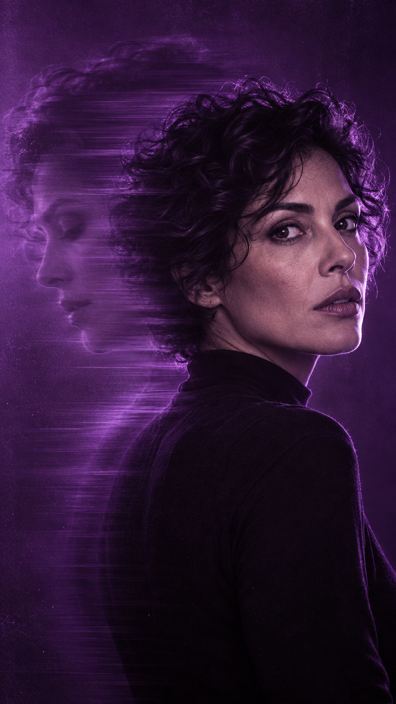
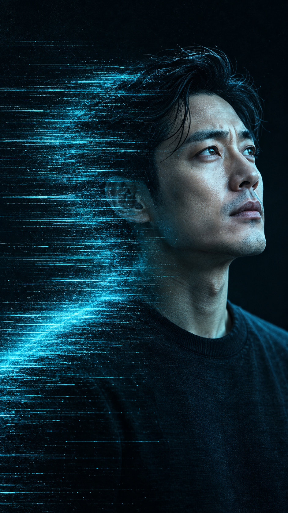
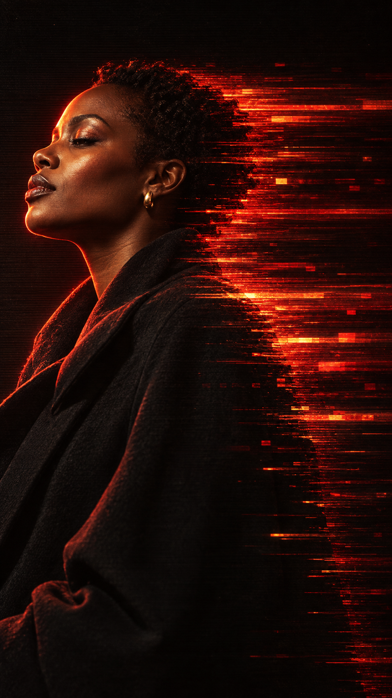
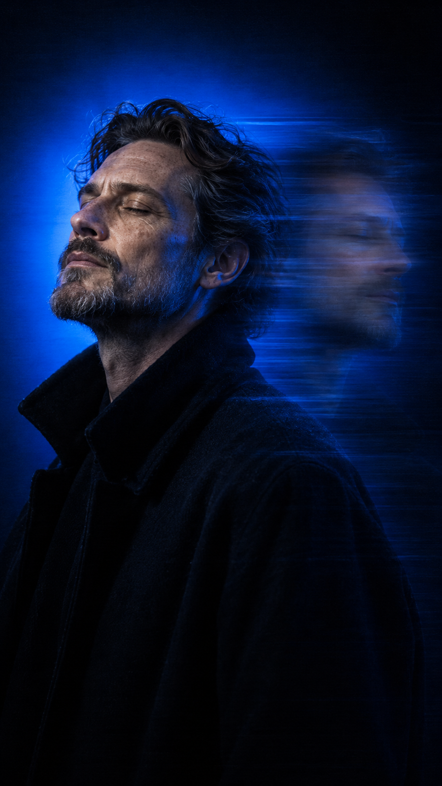

# Motion Echo Portraits

 |  |  | 

**[Português](README.md) · [English](README.en.md) · [Español](README.es.md)**

Guía abierta de retratos con eco de movimiento: referencia, cuatro propuestas de neón, prompts originales, revisión y práctica de una serie editorial.

[Guía de uso](https://linnoff88-dev.github.io/arckhe-/guia/es/)

Abre `guia/es/index.html` en el navegador para leerla de forma local. La copia de prompts funciona en HTTPS o localhost; cuando no está disponible, el texto se selecciona para copiarlo manualmente. Las notas y el tema usan el almacenamiento local del navegador.

El sitio es estático y no envía fotos ni llama a generadores. El usuario proporcionó los cuatro prompts originales en inglés de la guía AVCC · AI Video Creators. Las explicaciones y los ejercicios son complementos de ARCKHÉ. Todavía no se han probado mediante generación en esta entrega.

Versión: 1.1.0.

## Curso v6

[Curso v6](https://linnoff88-dev.github.io/arckhe-/es/landing.html) · 4 clases prácticas.

## Más en ARCKHÉ AI

[Ver el curso en ARCKHÉ AI](https://www.ARCKHÉ AI/cursos/319-motion-echo-v6-retratos-com-eco-de-movimento/)
