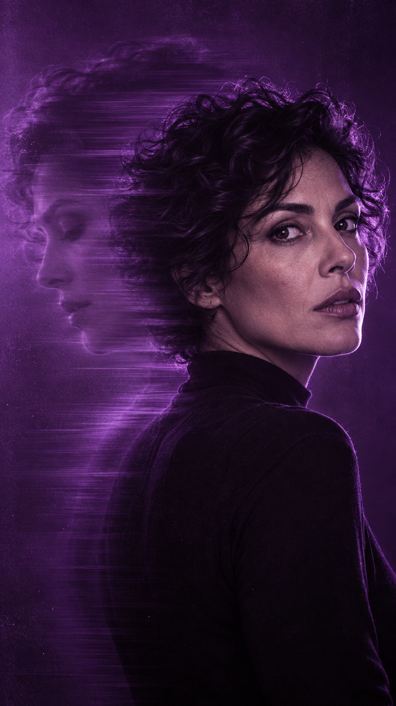
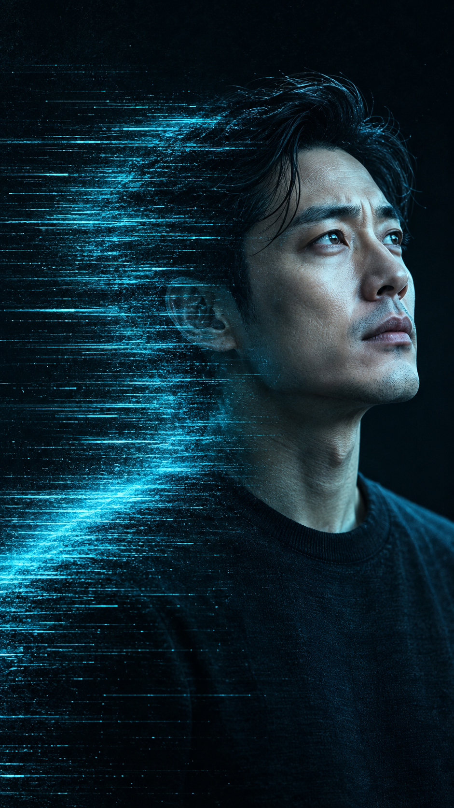
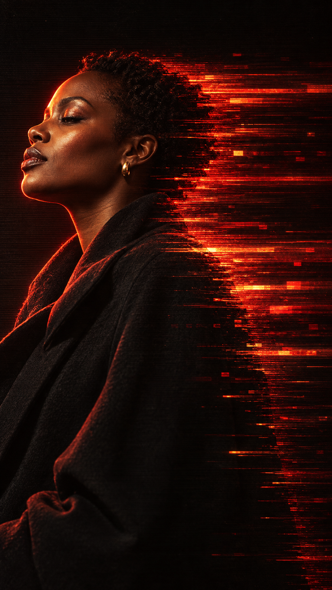

# Motion Echo Portraits

  
  
<strong>Arckhé AI</strong>

 |  |  | 

**[PortuguêƒÂªs](README.md) ê‚· [English](README.en.md) ê‚· [EspaêƒÂ±ol](README.es.md)**

Guia aberto de retratos com eco de movimento: referêƒÂªncia, quatro direêƒÂ§êƒÂµes neon, prompts originais, revisêƒÂ£o e prêƒÂ¡tica de uma sêƒÂ©rie editorial.

[Guia de uso](https://linnoff88-dev.github.io/arckhe-/guia/)

Abra `guia/index.html` no navegador para leitura local. Copiar prompts funciona em HTTPS ou localhost; quando indisponêƒÂ­vel, o texto êƒÂ© selecionado para cêƒÂ³pia manual. AnotaêƒÂ§êƒÂµes e tema usam armazenamento local do navegador.

O site êƒÂ© estêƒÂ¡tico e nêƒÂ£o envia fotos nem chama geradores. Os quatro prompts originais em inglêƒÂªs foram fornecidos pelo usuêƒÂ¡rio a partir do guia AVCC ê‚· AI Video Creators. As explicaêƒÂ§êƒÂµes e exercêƒÂ­cios sêƒÂ£o complementos ARCKHÉ. Ainda nêƒÂ£o foram testados por geraêƒÂ§êƒÂ£o nesta entrega.

VersêƒÂ£o: 1.1.0.

## Curso v6

[Curso v6](https://linnoff88-dev.github.io/arckhe-/landing.html) ê‚· 4 aulas prêƒÂ¡ticas.

## Mais no ARCKHÉ AI

[Ver a ficha no ARCKHÉ AI](https://www.ARCKHÉ AI/cursos/319-motion-echo-v6-retratos-com-eco-de-movimento/)

---

  
  
<strong>Arckhé AI</strong>

